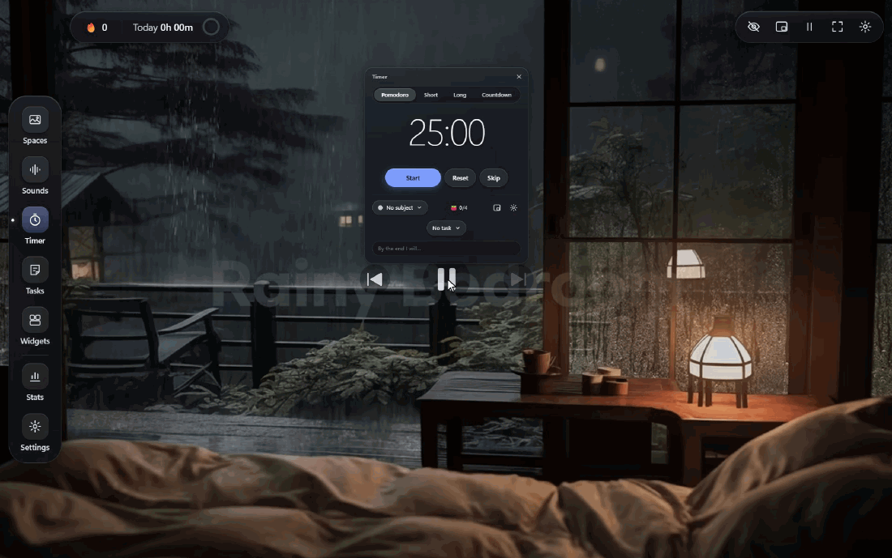
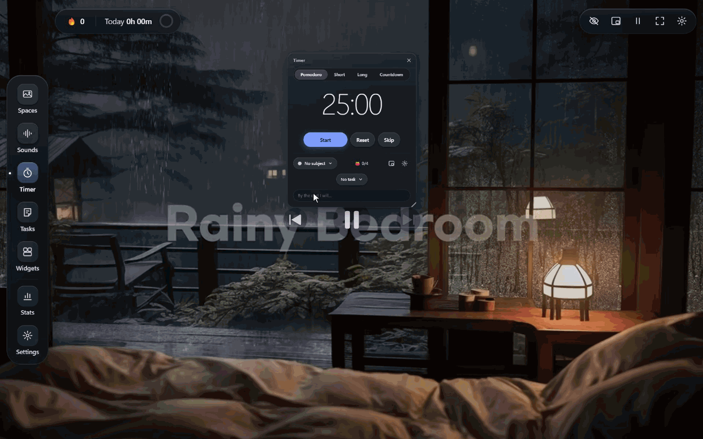
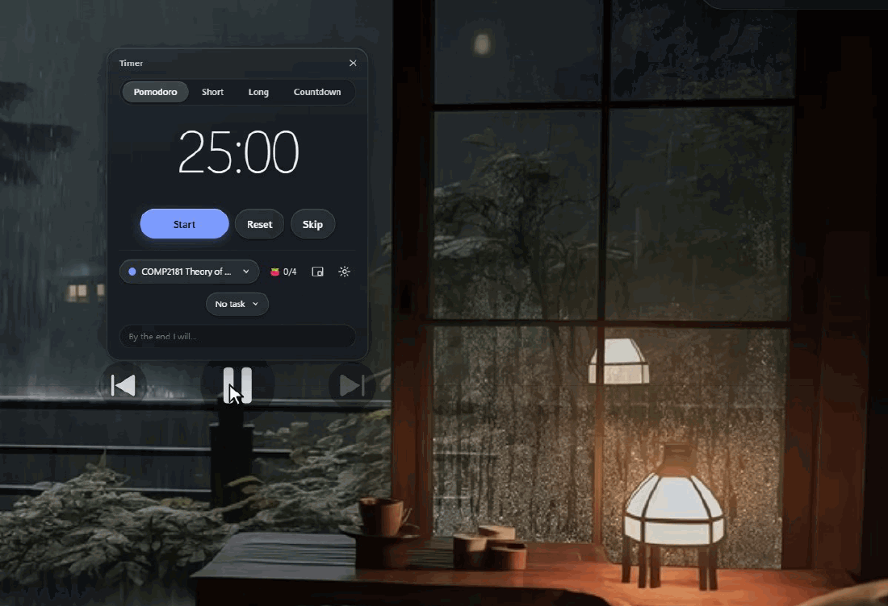
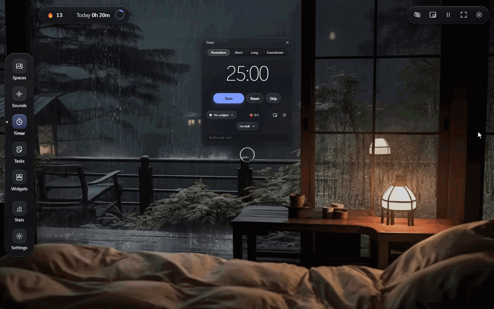

# StudyAt

A calm, local-only Windows study app. A looping space (video, image or YouTube) plays behind you.
On top sit a soundboard, a Pomodoro timer with chimes, sticky-note tasks, notes, deadlines and a
few small widgets. It is built around **honest study-time tracking**: only time on the focus timer
counts, so breaks, pauses, sleep, a locked PC and time away never do. From that it keeps streaks, a
study calendar, hours per week and per subject, and weekly recaps.



- [Install](#install)
- [Using StudyAt](#using-studyat)
- [Keyboard shortcuts](#keyboard-shortcuts)
- [Your data](#your-data)
- [Developing](#developing)
- [Contributing](#contributing)
- [Licence](#licence)

## Install

1. Download **StudyAt-Setup-x.y.z.exe** from the
   [latest release](https://github.com/SamsSide/StudyAt/releases/latest) and run it.
2. It installs for your Windows user only and adds Start-menu and desktop shortcuts.
3. The installer isn't code-signed, so Windows SmartScreen may say "Windows protected your PC".
   Choose **More info → Run anyway**.

When you install a newer version, your study history is kept. The database is backed up before it
upgrades.

## Using StudyAt

### The space

The window is your **space**: a looping video, a still image or a YouTube video. Open **Spaces**
in the left dock (or press `G`) to switch spaces. Add your own with a local video
(mp4/webm/mov), an image (jpg/png/webp/gif) or a YouTube link. Each space has its own settings:
its audio and volume, playback speed, dimming, blur and, for YouTube, a quality target. Press `V`
to pause or play the background. Press `H` for **focus view**, which hides everything except your
widgets.



### The timer

The **Timer** widget has four modes: **Pomodoro** (25 min), **Short** break (5), **Long** break
(15) and **Countdown** (one block of 1–240 min). You can change all the lengths.
- Pick a **subject** under the timer, so your hours are split by module. Subjects are managed in
  Settings.
- Optionally, pick a **task**, and write what you'll do this focus ("By the end I will…").
- A chime plays at the end of every segment. "Focus done" and "break done" have different chimes,
  and a 3-2-1 pip plays before each.
- **Closing the window hides StudyAt to the system tray.** The timer keeps running. A small
  always-on-top mini timer appears (or press `M`). Use **Quit** in the tray menu to exit.
- `Ctrl` + `Alt` + `P` starts or pauses the timer from anywhere in Windows.

### What counts as study time

Only time on a running **focus** segment (Pomodoro or Countdown) counts. Breaks and pauses don't,
and nor do sleep, a locked PC or the app merely being open. When your PC sleeps or locks, the
timer pauses by itself. After 10 minutes with no keyboard or mouse input, StudyAt asks whether to
keep or discard the time you were away. There is no "add time by hand": the numbers are only
worth something if they're honest.

### Tasks

**Tasks** (`T`) is a small stack of sticky notes.
- Type in "Add a task…" and press Enter. Pick one of six colours, click a note to edit it, and
  drag it by its handle (or use `Alt` + `↑`/`↓`) to reorder.
- Tick a note to move it into **Done**. **Clear done** removes the ticked ones.
- Hover a note and press **▶** to start focus on that task. Stats then shows your time per task.



### Sounds

**Sounds** (`K`) is a soundboard of looping ambience: rain, thunder, café, fireplace, ocean,
forest, wind and more, plus white, pink and brown noise.
- Mix as many sounds as you like, each with its own volume.
- Save a mix to bring it back in one click.
- Add your own sound files (mp3/ogg/wav).

### Stats

**Stats** (`S`) shows your study time in several views:
- today, this week (against last week) and your current and longest **streak** (a day counts once
  you reach 25 focused minutes, which you can change);
- a year-long **study calendar**;
- hours per day, per week, **per subject** and **per task**;
- every session, which you can filter and correct (change its subject, or delete it).

A **weekly recap** pops up after each Monday–Sunday week, and past recaps stay in Stats.



### Widgets

Open **Widgets** (`W`) to add more floating widgets:
- **Deadlines**, with live countdowns to your exams and coursework;
- **Notes**: sticky notes you can pop out onto the screen;
- **Stats widgets**: total time, time by subject, or goal and streak;
- **Calendar** (read-only, from Google Calendar's secret iCal address);
- **Weather** (from [Open-Meteo](https://open-meteo.com/));
- a daily **Quote**;
- your own **images and GIFs**;
- **Spotify** (controls playback in your Spotify app; needs Premium and your own free developer
  Client ID, as described in Settings → Spotify).

Every widget can be dragged and resized from its corner, and they remember where you left them.

## Keyboard shortcuts

Shortcuts are ignored while you're typing.

| Key | Does |
| --- | --- |
| `Space` | Start or pause the timer |
| `R` · `N` | Reset · skip |
| `1` `2` `3` `4` | Pomodoro · Short · Long · Countdown |
| `T` · `K` · `G` · `W` | Tasks · Sounds · Spaces · Widgets |
| `S` | Stats |
| `V` | Pause or play the background |
| `H` | Focus view (hide the interface) |
| `M` | Mini timer |
| `F` | Fullscreen |
| `Esc` | Close the top overlay or panel, or leave focus view |
| `?` | Help |
| `Ctrl` + `Alt` + `P` | Start or pause from anywhere in Windows |

## Your data

- **Everything stays on your PC**, in `%APPDATA%\StudyAt`. There are no accounts and no cloud.
- **Backups:**
  - the database is backed up every day (the last 14 are kept) and before every upgrade;
  - **Settings → Data** can restore one;
  - Settings can also export your sessions as JSON or CSV.
- **The optional extras only talk to their own services:**
  - Spotify uses your own Client ID, and its tokens stay on your PC;
  - your Google Calendar address is stored encrypted;
  - Weather sends only the place name you enter.

## Developing

StudyAt is Electron + React + TypeScript, built with electron-vite. It has no native Node
modules: storage is SQLite compiled to WebAssembly (sql.js).

- **Main process** (`src/main`): the timer state machine and session accounting, storage and
  migrations, backups, IPC, the tray and power/lock/idle handling.
- **Preload** (`src/preload`): a typed bridge to the renderer.
- **Renderer** (`src/renderer`): the React UI.
- **Shared** (`src/shared`): the shared types.
- **Core** (`src/core`): pure, clock-injected maths for stats, streaks and recaps.

### On Windows

You need Node.js 22+ and Git.

```bash
git clone https://github.com/SamsSide/StudyAt.git
cd StudyAt
npm ci
npm run dev        # run the app with hot reload
npm test           # unit tests (Vitest)
npm run typecheck
npm run lint
npm run e2e        # end-to-end tests (Playwright for Electron; run npm run build first)
npm run dist       # build the installer into release/
```

### WSL with a Windows mirror (how StudyAt itself is built)

The repo lives in WSL, and Electron runs on Windows:
- `./check.sh` runs the gate (typecheck, lint, unit tests) in WSL.
- `scripts/win.sh <command>` mirrors the repo to `C:\Users\<you>\dev\StudyAt` and runs the
  command there, for example `scripts/win.sh npm run dev`.

Add and change dependencies **in WSL only** (`npm install <pkg>`), so the lockfile is committed.
On Windows, only run `npm ci`.

### Where to read more

- [`docs/planning/appplan.md`](docs/planning/appplan.md): what the app does, section by
  section. Code comments cite it as "appplan §N".
- [`docs/planning/roadmap.md`](docs/planning/roadmap.md): what's done and what's next.
- [`assets/CREDITS.md`](assets/CREDITS.md): the source and licence of every bundled sound,
  chime and image.

## Contributing

Bug reports, ideas and pull requests are welcome. See [CONTRIBUTING.md](CONTRIBUTING.md) for how
to set up, the rules the code follows and what a good pull request looks like.

## Licence

StudyAt is **source-available** under the
[PolyForm Noncommercial License 1.0.0](LICENSE.md):
- **You may** use it, change it and share it, with or without your changes, for any
  noncommercial purpose. Personal study, schools and charities all count as noncommercial.
- **You may not** sell it or use it commercially.
- **When you share it,** keep the licence and the `Required Notice` line with it.

Bundled sounds, chimes and images keep their own licences, listed in
[`assets/CREDITS.md`](assets/CREDITS.md). StudyAt is an independent project, not affiliated with
LifeAt, Spotify, Google or YouTube.
